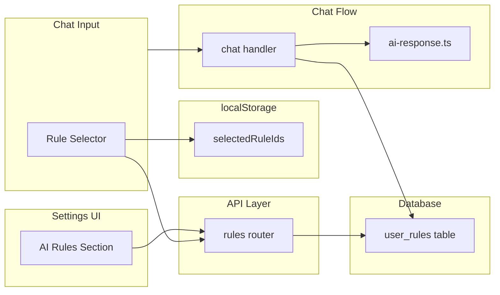

# User Rules Feature

## Architecture Overview



## 1. Database Schema

Create new table `user_rules` in [`packages/db/src/schema/user-rules.ts`](packages/db/src/schema/user-rules.ts):

```typescript
export const userRules = pgTable("user_rules", {
  id: uuid().primaryKey().defaultRandom(),
  userId: uuid()
    .notNull()
    .references(() => users.id, { onDelete: "cascade" }),
  title: text().notNull(), // Display name (e.g., "General", "Writing", "Coding")
  content: text().notNull(), // The rule text/instructions
  order: integer().notNull(), // For ordering rules in UI
  enabled: boolean().default(true).notNull(), // Can be disabled without deleting
  // projectId: uuid() - add later for project rules
  ...timestamps,
});
```

- Run `drizzle-kit generate` to create migration

## 2. Database Service

Create [`packages/db/src/service/user-rules.ts`](packages/db/src/service/user-rules.ts):

- `getUserRules(userId)` - get all rules ordered (for settings/selector)
- `getUserRulesByIds(userId, ruleIds)` - get specific rules by IDs (for chat)
- `createUserRule(userId, { title, content })` - add new rule
- `updateUserRule(id, userId, data)` - update rule title/content/order/enabled
- `deleteUserRule(id, userId)` - delete rule

## 3. API Routes

Create schema [`packages/api/src/schemas/user-rules.ts`](packages/api/src/schemas/user-rules.ts):

```typescript
// Rule output type
export const userRuleSchema = z.object({
  id: z.string().uuid(),
  title: z.string(),
  content: z.string(),
  order: z.number(),
  enabled: z.boolean(),
});

// Create input
export const createUserRuleInputSchema = z.object({
  title: z.string().min(1).max(100),
  content: z.string().min(1).max(10000),
});

// Update input
export const updateUserRuleInputSchema = z.object({
  id: z.string().uuid(),
  title: z.string().min(1).max(100).optional(),
  content: z.string().min(1).max(10000).optional(),
  enabled: z.boolean().optional(),
  order: z.number().optional(),
});
```

Create router [`packages/api/src/routers/user-rules.ts`](packages/api/src/routers/user-rules.ts):

- `list` - get user's rules (for selector and settings)
- `create` - add rule
- `update` - update rule
- `delete` - delete rule

Register in [`packages/api/src/router.ts`](packages/api/src/router.ts)

## 4. Settings UI

Add to [`apps/web/src/client/pages/settings/settings-layout.tsx`](apps/web/src/client/pages/settings/settings-layout.tsx):

- New nav item: "AI Rules" with `ScrollTextIcon`
- New section type: `"rules"`

Create [`apps/web/src/client/pages/settings/ai-rules-section.tsx`](apps/web/src/client/pages/settings/ai-rules-section.tsx):

- List of rules with title input + textarea for content
- Add new rule button
- Delete button per rule
- Enable/disable toggle per rule

## 5. Rule Selector Component

Create [`apps/web/src/client/components/chat/rule-selector.tsx`](apps/web/src/client/components/chat/rule-selector.tsx):

Similar to `tool-selector.tsx` but simpler (flat list, no hierarchy):

```typescript
type RuleSelectorProps = {
  selectedRuleIds: string[];
  onSelectedRuleIdsChange: (ids: string[]) => void;
  open?: boolean;
  onOpenChange?: (open: boolean) => void;
};
```

- Fetch rules via `rpcClient.userRules.list()`
- Show checkboxes for each rule (title + truncated content preview)
- Search/filter by title
- Badge showing count of selected rules
- Icon: `ScrollTextIcon` or `BookOpenIcon`

## 6. User Preferences

Update [`apps/web/src/client/hooks/use-user-preferences.ts`](apps/web/src/client/hooks/use-user-preferences.ts):

```typescript
type UserPreferences = {
  // ... existing
  selectedRuleIds: string[];  // IDs of selected user rules
};

// Add getters/setters
export const getSelectedRuleIds = (): string[] => ...
export const setSelectedRuleIds = (ids: string[]): void => ...
```

## 7. Chat Input Integration

Update [`apps/web/src/client/components/chat/chat-input.tsx`](apps/web/src/client/components/chat/chat-input.tsx):

- Add `RuleSelector` next to `ToolSelector`
- Props: `selectedRuleIds`, `onSelectedRuleIdsChange`

Update [`apps/web/src/client/components/chat/chat.tsx`](apps/web/src/client/components/chat/chat.tsx):

- Add state for `selectedRuleIds`
- Pass to `ChatInput`
- Pass to transport in `prepareSendMessagesRequest`
- Add hotkey for opening rule selector

## 8. Server Integration

Update [`packages/server/src/routes/api/chat/handler.ts`](packages/server/src/routes/api/chat/handler.ts):

- Accept `selectedRuleIds?: string[]` in request body
- Fetch rules by IDs: `getUserRulesByIds(userId, selectedRuleIds)`
- Pass rules to `executeAiResponseWithOrchestration`

Update [`packages/server/src/routes/api/chat/ai-response.ts`](packages/server/src/routes/api/chat/ai-response.ts):

- Add `userRules?: { title: string; content: string }[]` to `ExecuteAiResponseOptions`
- Prepend rules as user message before actual messages:

```typescript
// Prepend user rules as context message
const rulesContent = userRules?.length
  ? userRules.map(r => `[${r.title}]\n${r.content}`).join("\n\n")
  : null;

const messagesWithRules = rulesContent
  ? [{ role: "user" as const, content: rulesContent }, ...messages]
  : messages;

// Use messagesWithRules in streamText
messages: await convertToModelMessages(messagesWithRules),
```

## Key Files Summary

- `packages/db/src/schema/user-rules.ts` - Create table schema
- `packages/db/src/schema.ts` - Export schema
- `packages/db/src/service/user-rules.ts` - Create CRUD service
- `packages/db/src/service/index.ts` - Export service
- `packages/api/src/schemas/user-rules.ts` - Create Zod schemas
- `packages/api/src/routers/user-rules.ts` - Create router
- `packages/api/src/router.ts` - Register router
- `apps/web/src/client/pages/settings/settings-layout.tsx` - Add nav item
- `apps/web/src/client/pages/settings/ai-rules-section.tsx` - Create settings UI
- `apps/web/src/client/components/chat/rule-selector.tsx` - Create selector
- `apps/web/src/client/hooks/use-user-preferences.ts` - Add selectedRuleIds
- `apps/web/src/client/components/chat/chat-input.tsx` - Add RuleSelector
- `apps/web/src/client/components/chat/chat.tsx` - Wire up state/transport
- `packages/server/src/routes/api/chat/handler.ts` - Accept/fetch rules
- `packages/server/src/routes/api/chat/ai-response.ts` - Inject rules into messages
